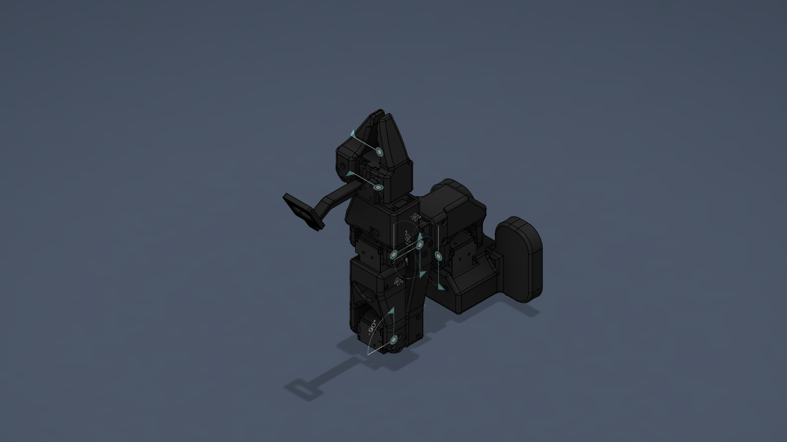

# Issac_sim_6DOF_ARM — Robot Description



## Overview

| Property | Value |
|----------|-------|
| Total mass | 0.580 kg |
| Links | 7 |
| Joints | 7 (6 movable) |
| Assemblies | 2 |
| Root link | `base_link` |

## Table of Contents

- [Kinematic Tree](#kinematic-tree)
- [Link Properties](#link-properties)
- [Joint Properties](#joint-properties)
- [Assembly Breakdown](#assembly-breakdown)
- [Quick Start (ROS 2)](#quick-start-ros-2)
- [Files](#files)

## Kinematic Tree

```
base_link
  └─ base_base_xl430 [fixed]
    J5 [BAKE]
      └─ gripper [revolute]
        gripper [BAKE]
  └─ base [revolute]
    J1 [BAKE]
      └─ shoulder [revolute]
        J2 [BAKE]
          └─ elbow [revolute]
            J3 [BAKE]
              └─ wrist_pitch [revolute]
                J4 [BAKE]
                  └─ wrist_roll [revolute]
                    J5 [BAKE]
                      └─ gripper [revolute]
                        gripper [BAKE]
```

## Link Properties

| Link | Mass (kg) | Material | Collision | Bodies |
|------|-----------|----------|-----------|--------|
| `J1` | 0.0904 | XL430_ABS_57_2g | box | 2 |
| `J2` | 0.0888 | XL430_ABS_57_2g | box | 2 |
| `J3` | 0.0877 | XL430_ABS_57_2g | box | 2 |
| `J4` | 0.0886 | XL430_ABS_57_2g | box | 2 |
| `J5` | 0.0862 | XL430_ABS_57_2g | box | 2 |
| `base_link` | 0.1246 | PLA_base_link_67_43g | box | 1 |
| `gripper` | 0.0138 | PLA_part_13_81g | box | 1 |

## Joint Properties

| Joint | Type | Parent → Child | Axis | Limits |
|-------|------|---------------|------|--------|
| `base` | revolute | `base_link` → `J1` | (-0,1,0) | [90.0°, 270.0°] |
| `base_base_xl430` | fixed | `base_link` → `J5` | (0,0,1) | — |
| `elbow` | revolute | `J2` → `J3` | (-0,-0,1) | [-90.0°, 90.0°] |
| `gripper` | revolute | `J5` → `gripper` | (0,0,1) | [-90.0°, 5.0°] |
| `shoulder` | revolute | `J1` → `J2` | (-0,-0,1) | [-90.0°, 90.0°] |
| `wrist_pitch` | revolute | `J3` → `J4` | (0,-1,-0) | [-180.0°, 0.0°] |
| `wrist_roll` | revolute | `J4` → `J5` | (-1,-0,0) | [-175.0°, 175.0°] |

## Assembly Breakdown

### Issac_sim_6DOF_ARM

- **Links**: base_link, gripper
- **Total mass**: 0.138 kg

### XL_430

- **Links**: J1, J2, J3, J4, J5
- **Total mass**: 0.442 kg

## Quick Start (ROS 2)

```bash
# 1. Copy package to your ROS 2 workspace
cp -r lerobot_ver2 ~/ros2_ws/src/

# 2. Build
cd ~/ros2_ws
colcon build --packages-select lerobot_ver2
source install/setup.bash

# 3. Visualize in RViz2
ros2 launch lerobot_ver2 display.launch.py

# 4. Validate URDF structure
check_urdf install/lerobot_ver2/share/lerobot_ver2/urdf/Issac_sim_6DOF_ARM.urdf

# 5. Print kinematic tree
urdf_to_graphviz install/lerobot_ver2/share/lerobot_ver2/urdf/Issac_sim_6DOF_ARM.urdf
```

**Joint control**: The launch file includes `joint_state_publisher_gui` —
use the sliders to move revolute/prismatic joints in RViz2.

**Topic inspection**:
```bash
# See published joint states
ros2 topic echo /joint_states

# See robot description parameter
ros2 param get /robot_state_publisher robot_description
```

## Files

| Path | Description |
|------|-------------|
| `urdf/Issac_sim_6DOF_ARM.urdf.xacro` | Top-level xacro (entry point) |
| `urdf/Issac_sim_6DOF_ARM.urdf` | Flat URDF (for validation) |
| `urdf/assemblies/` | Per-assembly xacro macros |
| `meshes/` | Visual (OBJ) and collision (STL) meshes |
| `launch/display.launch.py` | Launch robot_state_publisher, RViz, and generated controllers |
| `config/joint_state.yaml` | Joint state publisher config |
| `config/ros2_controllers.yaml` | Generated ros2_control controller manager config |
| `robot_data.yaml` | Supplementary data (beyond URDF) |
| `docs/transforms.md` | Transformation matrices (KaTeX) |

## Customizing

Assemblies tagged `!dummy_` are designed to be swapped out. To replace one:

1. Create your replacement as a xacro macro with the same interface
2. Place it in `urdf/assemblies/`
3. Update the `<xacro:include>` in `urdf/Issac_sim_6DOF_ARM.urdf.xacro`
4. Update meshes in `meshes/<your_assembly>/`

The xacro prefix system (`${prefix}`) ensures link names stay unique
when multiple instances of the same assembly are used.

---
*Generated by Fusion URDF/XACRO Exporter v3.0.0*